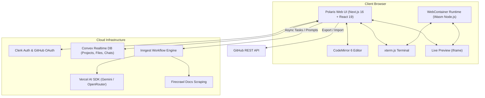

<div align="center">


# 🌌 Polaris — AI-Powered Online Cloud Code Editor

**The Next-Generation In-Browser Cloud IDE with WebContainers, Multi-Model AI Copilots, and Seamless GitHub Synchronization.**

[](https://nextjs.org/)
[](https://react.dev/)
[](https://www.typescriptlang.org/)
[](https://tailwindcss.com/)
[](https://www.convex.dev/)
[](https://clerk.com/)
[](https://webcontainers.io/)
[](https://www.inngest.com/)

[Features](#-features) • [Tech Stack](#-tech-stack) • [Architecture](#-architecture) • [Getting Started](#-getting-started) • [Environment Variables](#-environment-variables) • [Project Structure](#-project-structure)

</div>

---

## 🌟 Overview

**Polaris** is a full-featured, zero-latency cloud code editor running entirely inside modern web browsers. Leveraging the power of **WebContainers API**, Polaris boots a genuine Node.js runtime locally inside a browser tab without relying on expensive remote virtual machines.

Supercharged by **multi-model AI agents**, **Inngest Agent Kit**, **Firecrawl web scraping**, and **Convex realtime sync**, Polaris empowers developers to scaffold, edit, run, debug, and export full-stack web applications straight to GitHub with zero friction.

---

## ✨ Features

### 🖥️ In-Browser Execution & Virtual File System
- **WebContainers Runtime**: Boots full-stack Node.js environments inside browser WebAssembly.
- **Interactive xterm.js Terminal**: Run `npm install`, start dev servers, inspect process outputs, and execute shell commands with custom fit addons and ANSI color support.
- **Live Preview Window**: Auto-detects running ports (e.g. `localhost:3000`, `localhost:5173`) and renders a live, hot-reloading iframe with custom URL navigation and responsive controls.
- **Dynamic File Explorer**: Full directory navigation, recursive folder hierarchies, creation, renaming, deletion, and file upload capabilities.

### 🧠 Intelligent AI Coding Assistant
- **Prompt-to-Project Generation**: Turn plain English specifications into structured projects with scaffolding, files, and dependencies automatically created.
- **Surgical Quick-Edit Mode**: Select any code snippet and apply precise, context-aware diff modifications without altering surrounding logic or formatting.
- **Context-Aware Docs Scraping (Firecrawl)**: Automatically detects documentation URLs in user prompts, scrapes live Markdown documentation, and grounds LLM responses with real-time API context.
- **Multi-Model Orchestration**: Powered by the Vercel AI SDK, with configurable models across Google Gemini and OpenRouter (MiniMax, Claude, GPT-4o).
- **Background Agent Execution (Inngest)**: Durable, step-based AI tasks with automatic retries, cancellation, and progress streaming.

### ⚡ Real-Time Collaboration & Persistence
- **Convex Database**: Real-time subscriptions for projects, nested file trees, chat conversations, and execution statuses.
- **Instant Cloud Sync**: Never lose a keystroke; modifications are saved to the cloud instantaneously with optimistic updates.
- **History & Past Conversations**: Search, revisit, or restore previous AI chats and code evolution timelines.

### 🐙 Seamless GitHub Integration
- **Import from GitHub**: Import public or private repositories directly into a fresh Polaris project via Clerk OAuth tokens.
- **One-Click Export**: Push the entire in-memory virtual workspace directly to a new or existing GitHub repository with real-time progress tracking and cancellation handling.

### 🎨 Modern Code Editor (CodeMirror 6)
- Syntax highlighting for JavaScript, TypeScript, Python, HTML, CSS, JSON, and Markdown.
- Indentation markers, code folding, minimap preview, auto-closing brackets, and active line indicators.
- Seamless Dark and Light theme integration powered by `next-themes`.

---

## 🛠️ Tech Stack

| Domain | Technology / Library |
|---|---|
| **Framework** | [Next.js 16](https://nextjs.org/) (App Router, Server Actions, Route Handlers) |
| **UI & Styling** | [React 19](https://react.dev/), [Tailwind CSS v4](https://tailwindcss.com/), [Motion](https://motion.dev/), [Lucide React](https://lucide.dev/) |
| **Components** | [Radix UI](https://www.radix-ui.com/), [Sonner](https://sonner.emilkowal.ski/), [Cmdk](https://cmdk.paco.me/), [Allotment](https://allotment.mulberryhouse.io/) |
| **Code Editor** | [CodeMirror 6](https://codemirror.net/), One Dark theme, indentation markers, minimap |
| **Terminal & Runtime** | [@webcontainer/api](https://webcontainers.io/), [@xterm/xterm](https://xtermjs.org/), `@xterm/addon-fit` |
| **Database & Realtime** | [Convex](https://www.convex.dev/) |
| **Authentication** | [Clerk](https://clerk.com/) (OAuth, GitHub provider, session management) |
| **AI Workflows** | [Vercel AI SDK](https://sdk.vercel.ai/), [Inngest](https://www.inngest.com/) Agent Kit |
| **AI Models** | Google Gemini (`@ai-sdk/google`), OpenRouter (`@ai-sdk/openai`) |
| **Web Scraping** | [Firecrawl](https://firecrawl.dev/) (`@mendable/firecrawl-js`) |
| **GitHub API** | [Octokit](https://github.com/octokit/octokit.js) |
| **Monitoring** | [Sentry](https://sentry.io/) (Next.js client, server, and edge tracing) |

---

## 🏗️ Architecture



---

## 📋 Prerequisites

Before running Polaris locally, ensure you have:

- **Node.js**: `v20.x` or higher installed
- **Package Manager**: `npm`, `pnpm`, or `bun`
- Accounts for third-party services:
  - [Clerk Account](https://clerk.com) for authentication & GitHub OAuth
  - [Convex Account](https://convex.dev) for realtime data storage
  - [Google AI Studio](https://aistudio.google.com/) or [OpenRouter](https://openrouter.ai/) for AI model access
  - [Firecrawl](https://firecrawl.dev/) for context web scraping
  - [Inngest Account](https://inngest.com) (or local Inngest Dev Server)

> [!IMPORTANT]
> **Cross-Origin Isolation**: WebContainers require `SharedArrayBuffer`, which mandates specific HTTP response headers (`Cross-Origin-Embedder-Policy: credentialless` and `Cross-Origin-Opener-Policy: same-origin`). These are pre-configured in `next.config.ts`.

---

## 🚀 Getting Started

### 1. Clone the Repository

```bash
git clone https://github.com/Aasutosh23/polaris.git
cd polaris
```

### 2. Install Dependencies

```bash
npm install
# or
pnpm install
```

### 3. Setup Environment Variables

Copy the sample environment file and configure your keys:

```bash
cp .env.example .env.local
```

Open `.env.local` and provide your API keys (see [Environment Variables](#-environment-variables) for descriptions).

### 4. Initialize Convex

In a separate terminal tab, initialize and run your Convex development backend:

```bash
npx convex dev
```

This will link your project with Convex, run schema migrations, and generate TypeScript typings in `convex/_generated/`.

### 5. Start the Inngest Dev Server

To handle background AI functions and agent workflows locally:

```bash
npx inngest-cli@latest dev
```

The Inngest dashboard will be available at `http://localhost:8288`.

### 6. Start the Polaris Development Server

```bash
npm run dev
```

Open [http://localhost:3000](http://localhost:3000) in your browser to start coding in Polaris!

---

## 🔑 Environment Variables

| Variable | Description | Source |
|---|---|---|
| `NEXT_PUBLIC_CLERK_PUBLISHABLE_KEY` | Clerk frontend publishable key | [Clerk Dashboard](https://dashboard.clerk.com) |
| `CLERK_SECRET_KEY` | Clerk backend secret key | [Clerk Dashboard](https://dashboard.clerk.com) |
| `CLERK_JWT_ISSUER_DOMAIN` | Clerk JWT Issuer Domain for Convex authentication | Clerk JWT Templates |
| `CONVEX_DEPLOYMENT` | Target Convex deployment ID | `npx convex dev` |
| `NEXT_PUBLIC_CONVEX_URL` | Convex cloud endpoint URL | Convex Project Settings |
| `NEXT_PUBLIC_CONVEX_SITE_URL` | Convex HTTP actions endpoint | Convex Project Settings |
| `POLARIS_CONVEX_INTERNAL_KEY` | Secret token to authenticate internal API routes with Convex | Custom secure string |
| `GOOGLE_GENERATIVE_AI_API_KEY` | Google Gemini API key for AI coding agents | [Google AI Studio](https://aistudio.google.com) |
| `OPENROUTER_API_KEY` | OpenRouter API Key for multi-model LLM generation | [OpenRouter](https://openrouter.ai) |
| `FIRECRAWL_API_KEY` | Firecrawl API Key to scrape and parse documentation URLs | [Firecrawl](https://firecrawl.dev) |
| `INNGEST_DEV` | Enable local Inngest development mode (`true` / `false`) | Local config |
| `SENTRY_AUTH_TOKEN` | (Optional) Sentry build and source map token | [Sentry](https://sentry.io) |
| `NEXT_PUBLIC_SENTRY_DSN` | (Optional) Sentry client DSN for error telemetry | Sentry Project Settings |

---

## 📁 Project Structure

```text
polaris/
├── convex/                  # Convex backend schema, mutations, queries & actions
│   ├── _generated/          # Auto-generated Convex client bindings
│   ├── auth.config.ts       # Clerk authentication provider configuration
│   ├── conversations.ts     # Chat conversations and message mutations
│   ├── files.ts             # Virtual file system queries and mutations
│   ├── projects.ts          # Project CRUD operations
│   └── schema.ts            # Database schema definitions
├── public/                  # Static assets and icons
├── src/
│   ├── app/                 # Next.js 16 App Router
│   │   ├── api/             # API routes (Inngest, GitHub, AI messages, quick-edit)
│   │   │   ├── github/      # GitHub import and export endpoints
│   │   │   ├── inngest/     # Inngest webhook entry point
│   │   │   ├── messages/    # Conversation message streaming
│   │   │   ├── projects/    # Prompt-to-project creation
│   │   │   ├── quick-edit/  # Surgical code modification endpoint
│   │   │   └── suggestion/  # AI code suggestion route
│   │   ├── projects/[projectId]/ # Dynamic IDE workspace route
│   │   ├── layout.tsx       # Root layout with font and providers
│   │   └── page.tsx         # Dashboard / Projects landing view
│   ├── components/          # Reusable UI components (Radix primitives, modals)
│   ├── features/            # Feature-driven modular architecture
│   │   ├── auth/            # Auth modal, login buttons, Clerk integrations
│   │   ├── conversations/   # Chat sidebar, streaming bubbles, history
│   │   ├── editor/          # CodeMirror 6 setup, extensions, tab bar
│   │   ├── preview/         # WebContainer preview iframe, port settings
│   │   └── projects/        # File tree explorer, project management dialogs
│   ├── inngest/             # Inngest client, step functions & event handlers
│   └── lib/                 # Shared utilities, AI model helpers, Firecrawl client
├── next.config.ts           # Next.js config with COOP/COEP headers & Sentry wrapper
└── package.json             # Project metadata and dependencies
```

---

## ⌨️ Available Scripts

| Command | Action |
|---|---|
| `npm run dev` | Starts the Next.js local development server on `localhost:3000` |
| `npm run build` | Builds the production bundle with Next.js and Sentry instrumentation |
| `npm run start` | Boots the compiled production server |
| `npm run lint` | Runs ESLint 9 checks across all source files |
| `npx convex dev` | Starts the Convex real-time synchronization backend |
| `npx inngest-cli@latest dev` | Runs the local Inngest background event processing dashboard |

---

## 🤝 Contributing

Contributions, issues, and feature requests are welcome!

1. Fork the Project
2. Create your Feature Branch (`git checkout -b feature/AmazingFeature`)
3. Commit your Changes (`git commit -m 'Add some AmazingFeature'`)
4. Push to the Branch (`git push origin feature/AmazingFeature`)
5. Open a Pull Request

---

## 📄 License

This project is licensed under the [MIT License](LICENSE).

---

<div align="center">
Made with ❤️ for developers who build in the browser.
</div>
